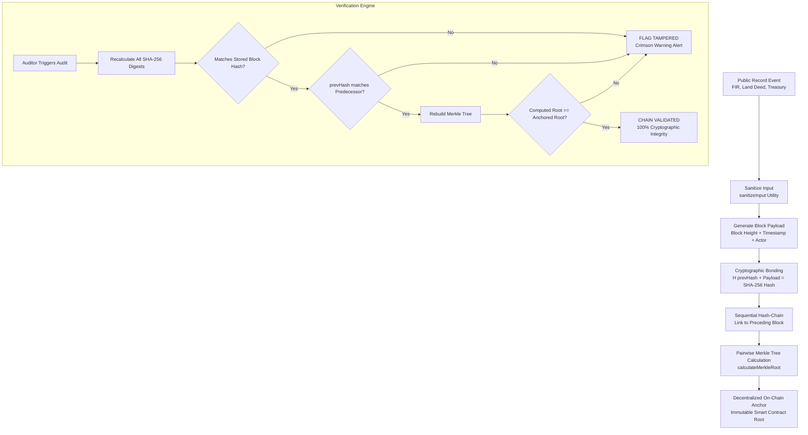

# Byte Forge // GovChain Sentinel

<div align="center">


### Cryptographic Compliance & Tamper-Evident Audit Logging Mesh

[](https://react.dev/)
[](https://vitejs.dev/)
[](https://tailwindcss.com/)
[](#6-how-the-project-works)
[](https://oxc.rs)
[](LICENSE)

**A high-assurance Security Operations Center (SOC) portal and cryptographic verification engine designed to detect unauthorized modifications in high-stakes public sector audit logs.**

[Explore Overview](#1-project-overview) • [Key Features](#4-key-features) • [How It Works](#6-how-the-project-works) • [Quick Start](#7-installation-and-setup-instructions) • [Architecture](#9-project-folder-structure)

</div>

---

## 1. Project Overview

**Byte Forge** presents **GovChain Sentinel** — a specialized cybersecurity and cryptographic auditing platform engineered to ensure the mathematical immutability of mission-critical public records. 

In traditional enterprise and municipal government architectures, audit logs reside inside centralized relational databases (e.g., standard SQL tables). If an insider acquires administrative database privileges or an attacker breaches the perimeter, records can be retroactively altered or deleted without leaving a verifiable trace.

**GovChain Sentinel** solves this systemic vulnerability by structuring government event logs into a continuous, forward-dependent **SHA-256 cryptographic hash-chain** paired with **binary Merkle Tree root commitments**. Any unauthorized change—down to a single altered character in a court FIR, land title deed, or treasury disbursement—breaks the hash-chain link, causes the computed Merkle root to diverge from the anchored benchmark, and immediately triggers real-time visual alerts across the SOC dashboard.

---

## 2. Problem Statement

Modern governance infrastructure handles millions of sensitive transactions daily across departments such as Judiciary benches, Revenue and Land Registries, and State Treasuries. Despite access control lists (ACLs) and database backups, current systems face critical security flaws:

* **Silent SQL Row Modification**: Privileged administrators, rogue database operators, or attackers executing direct SQL queries (e.g., `UPDATE fir_records SET status='DISMISSED'`) can alter historical facts without triggering application-level logs.
* **Retroactive Land & Deed Alterations**: Property boundaries and title transfers are vulnerable to unauthorized historical tampering years after execution, while conventional backups merely duplicate the corrupted state.
* **Asymmetric Trust & Unverifiable Audits**: Citizens, ombudsmen, and external compliance officers must place blind faith in the centralized authority hosting the server. There is no independent, mathematical proof of record veracity.
* **Lack of Instant Forensic Detection**: Database breaches often remain undiscovered for weeks or months due to the absence of continuous, automated hash-verification telemetry.

---

## 3. Project Objectives

1. **Enforce Mathematical Immutability**: Implement sequential SHA-256 hash chaining where every block incorporates the cryptographic digest of its predecessor (`H(prev || payload)`), ensuring backward dependencies cannot be rewritten.
2. **Decentralized Root Verification**: Batch audit blocks into pairwise Merkle trees and anchor the 32-byte Merkle root against a simulated smart contract state.
3. **Sub-Millisecond Tamper Detection**: Provide client-side audit engines capable of recalculating the entire ledger's integrity and isolating corrupted records in real time.
4. **Adversarial Penetration Simulation**: Supply administrators with a dedicated simulation laboratory to test and demonstrate system resilience against realistic insider attack vectors.
5. **Zero-Trust Public Accessibility**: Offer an intuitive, transparent interface allowing both authorized auditors and external observers to verify data integrity without requiring specialized blockchain tooling.

---

## 4. Key Features

### 🛡️ Cyber Security Operations Center (SOC) Dashboard
* **Telemetry Gauges**: Real-time counters showing anchored block heights, sub-millisecond tamper detection latency, node validator statuses, and hash-chain continuity rates.
* **Live Ingestion Feed**: Toggleable background streaming simulator (`isStreaming`) injecting new municipal, judicial, and treasury events on a periodic cadence.
* **Session Telemetry**: Real-time operator session tracking with active IP tagging, clearance badges, and session uptime monitoring.

### 🔗 Cryptographic Hash-Chain Inspector
* **Node-by-Node Explorer**: Deep inspection of every individual block containing block height, ISO timestamps, issuing department, actor identity, action type, and raw payload data.
* **Cryptographic Dependency Visualizer**: Displays exact `prevHash` and `currentHash` pairs with one-click clipboard copying.
* **Status Badges**: Instant visual identification of anchored (valid) vs. divergent (tampered) nodes.

### 🔍 Zero-Trust Verification Engine
* **Step-by-Step Diagnostic Terminal**: Visual, animated audit sequence walking through block scanning, SHA-256 recomputation, forward-link validation, Merkle hierarchy construction, and on-chain root comparison.
* **Root Discrepancy Breakdown**: Side-by-side comparison between the computed Merkle root and the immutable on-chain reference anchor.
* **Forensic Audit Reporting**: Identifies specific corrupted block IDs and broken chain indices.

### 🧪 Adversarial Tamper Simulation Lab (Admin Only)
* **Pre-Configured Attack Scenarios**:
  * **High Court FIR Dismissal**: Simulates altering criminal charges and bail statuses in judicial records.
  * **Land Conveyance Deed Grantee Hijack**: Modifies title deed ownership recipients and survey plot assignments.
  * **Treasury Disbursement Divergence**: Re-routes municipal grant payments to unauthorized accounts.
  * **Custom Payload Injection**: Allows custom JSON key-value modifications on any block.
* **Instant Chain Invalidation**: Demonstrates immediate hash mismatch and downstream chain rupture.
* **Recovery Mechanisms**: Includes single-record restoration and full ledger genesis reset options.

### 🔐 Authentication & Role-Based Access Control (RBAC)
* **Clearance Levels**:
  * **Admin**: Level-5 Directive Access with complete administrative authority, tamper simulation controls, and ledger resets.
  * **Normal User (Field Auditor)**: Level-2 clearance restricted to read-only log review and cryptographic verification.
* **Instant Role Switching**: Quick-toggle mechanism allowing portfolio reviewers and interviewers to evaluate both privilege tiers without re-authenticating.
* **Client-Side XSS Sanitizer**: Custom sanitization pipeline (`sanitizeInput`) stripping malicious `<script>` tags, iframe embeds, inline event handlers (`onload`, `onerror`), and dangerous URI protocols (`javascript:`).

### 🎨 Cyberpunk SOC Aesthetic & Theme Engine
* Dark-mode-first aesthetic with custom neon cyan and emerald glows, CRT-style scanline overlays, and responsive layouts.
* Fully functional Dark / Light theme toggle persisted in `localStorage`.

---

## 5. Technologies and Tools Used

| Category | Technology / Library | Version | Purpose |
| :--- | :--- | :--- | :--- |
| **Frontend Framework** | [React](https://react.dev/) | `^19.2.8` | Declarative component UI and state lifecycle management |
| **Runtime & Bundler** | [Vite](https://vitejs.dev/) | `^8.3.0` | Ultra-fast development server and production bundler |
| **Styling & Design System** | [Tailwind CSS](https://tailwindcss.com/) | `^4.3.3` | Utility-first styling with `@tailwindcss/vite` |
| **Icons & Visual Assets** | [Lucide React](https://lucide.dev/) | `^1.56.0` | Modern, lightweight iconography for cyber telemetry |
| **Cryptographic Hashing** | Native Web Crypto API + Fallback | Native | SHA-256 digest computation (`crypto.subtle`) with pure JS bitwise fallback |
| **Code Quality & Linting** | [Oxlint](https://oxc.rs/) | `^1.81.0` | High-performance Rust-based JavaScript / React linter |
| **State Management** | React Context API | Native | Centralized `AuthContext`, `AuditContext`, and `RouterContext` |

---

## 6. How the Project Works



### 1. Cryptographic Record Bonding
When an audit block is created, its core properties are serialized into a strict pipe-delimited format:
```text
${prevHash}|${blockHeight}|${timestamp}|${department}|${action}|${rawPayload}|${actor}
```
This string is passed through **SHA-256** to generate the block's unique `currentHash`.

### 2. Forward Dependency Chaining
Each consecutive block incorporates the exact `currentHash` of the previous block as its `prevHash`. Because hash functions are one-way and collision-resistant, altering a single character in Block #1001 changes its hash, breaking the link with Block #1002 and invalidating every subsequent block.

### 3. Merkle Root Generation
Rather than posting every individual log to an expensive distributed ledger, blocks are paired iteratively and hashed in a binary Merkle tree:
```javascript
// Pairwise tree reduction to a single 32-byte root
while (currentLevel.length > 1) {
  const nextLevel = []
  for (let i = 0; i < currentLevel.length; i += 2) {
    const left = currentLevel[i]
    const right = i + 1 < currentLevel.length ? currentLevel[i + 1] : left
    nextLevel.push(fallbackSha256(left + right))
  }
  currentLevel = nextLevel
}
```
The resulting root (`0x...`) serves as an immutable fingerprint for the entire dataset.

### 4. Zero-Trust Real-Time Auditing
When an auditor runs the Verification Engine:
1. Every block's SHA-256 hash is independently recomputed from its raw data.
2. Every block's `prevHash` is checked against its predecessor's computed hash.
3. The Merkle root is recalculated and compared with the on-chain anchor reference.
4. If any discrepancy exists, the compromised record is highlighted in crimson, detailing the exact corrupted block ID.

---

## 7. Installation and Setup Instructions

### Prerequisites
Make sure the following tools are installed on your machine:
* **Node.js**: `v18.0.0` or higher (recommended: `v20.x` or `v22.x`)
* **npm**: `v9.0.0` or higher (bundled with Node.js)
* **Git**: Installed and configured

### Clone the Repository
```bash
git clone <your-github-repository-url>
cd BYTE-FORGE
```

### Install Dependencies
Install all required production and development dependencies:
```bash
npm install
```

---

## 8. Steps to Run the Project

### Start Development Server
Launch the local Vite development server with Hot Module Replacement (HMR):
```bash
npm run dev
```
Open your browser and navigate to:
```
http://localhost:5173
```

### Demo Accounts & Quick-Login
On the `/login` screen, use the convenient one-click **Quick Fill** buttons or enter the demo credentials:

| Role | Name | Email | Clearance |
| :--- | :--- | :--- | :--- |
| **Administrator** | Commander Vikram Dev | `v.dev@sentinel.gov.in` | Level-5 Directive Access |
| **Field Auditor** | Officer Priya Sen | `priya.sen@auditor.gov.in` | Level-2 Field Auditor |

*(Note: You can also freely switch roles at any time via the top header bar.)*

### Lint Code
Validate the codebase using the ultra-fast Oxlint linter:
```bash
npm run lint
```

### Build for Production
Create an optimized, minified production bundle in the `dist/` directory:
```bash
npm run build
```

### Preview Production Build
Locally preview the generated production build:
```bash
npm run preview
```

---

## 9. Project Folder Structure

```plaintext
BYTE FORGE/
├── public/                       # Static public assets
│   ├── favicon.svg               # SVG Shield favicon
│   └── icons.svg                 # SVG sprite definitions
├── src/                          # Application source code
│   ├── assets/                   # Visual assets and hero graphics
│   │   ├── hero.png              # Sentinel SOC hero banner
│   │   ├── react.svg             # React logo
│   │   └── vite.svg              # Vite logo
│   ├── components/               # Modular React UI components
│   │   ├── layout/               # Global layout wrappers
│   │   │   ├── Navbar.jsx        # Sticky navigation bar with role & theme toggles
│   │   │   └── Footer.jsx        # Security telemetry & compliance footer
│   │   └── ui/                   # Reusable atomic UI elements
│   │       └── CyberCard.jsx     # Cyberpunk styled card container
│   ├── context/                  # React Context state providers
│   │   ├── AuditContext.jsx      # Ledger state, streaming, hash-chain & verification
│   │   ├── AuthContext.jsx       # User authentication, RBAC clearance & theme state
│   │   └── RouterContext.jsx     # Client-side routing engine
│   ├── data/                     # Mock data & initial ledger states
│   │   └── mockLogs.js           # Genesis blocks across Judiciary, Land, & Treasury
│   ├── pages/                    # Application route views
│   │   ├── LandingPage.jsx       # Public landing page with problem/solution tabs
│   │   ├── LoginPage.jsx         # Secure access portal with XSS sanitization & quick-fill
│   │   ├── DashboardHome.jsx     # Core SOC command center & telemetry overview
│   │   ├── LiveLogsPage.jsx      # Searchable & filterable audit ledger
│   │   ├── HashChainPage.jsx     # Sequential SHA-256 node-by-node inspector
│   │   ├── VerificationPage.jsx  # Interactive zero-trust audit terminal & report generator
│   │   ├── SimulationsPage.jsx   # Admin-only adversarial tamper simulation lab
│   │   └── SettingsPage.jsx      # Session management, clearance, & appearance
│   ├── utils/                    # Core mathematical and security utilities
│   │   └── crypto.js             # SHA-256 hashing, Merkle Tree builder, XSS sanitizer
│   ├── App.css                   # Custom animation keyframes and glow effects
│   ├── App.jsx                   # Main application root and route resolver
│   ├── index.css                 # Global Tailwind CSS imports & theme tokens
│   └── main.jsx                  # Application entry point
├── .gitignore                    # Excluded files (node_modules, dist, .env, secrets)
├── .oxlintrc.json                # Oxlint linter configuration
├── index.html                    # HTML entry point with Google Fonts preconnect
├── package.json                  # Project dependencies and npm scripts
├── package-lock.json             # Pinned dependency tree
├── vite.config.js                # Vite build and plugin configurations
└── README.md                     # Project documentation
```

---

## 10. Screenshots & Interface Showcase

| View | Purpose & Functionality |
| :--- | :--- |
| **SOC Landing Portal** | Overview of centralized vulnerabilities vs. cryptographic mesh solutions, network telemetry counters, and live ledger previews. |
| **SOC Command Dashboard** | High-level operations center featuring active operator session details, quick role switching, streaming log toggle, and recent block activity. |
| **Audit Ledger Feed** | Multi-department searchable log table with filters for Judiciary, Land Registry, Treasury, Customs, and Civil records. |
| **Hash-Chain Inspector** | Visual block graph tracing predecessor links (`prevHash`) to current SHA-256 hashes with copyable hex values. |
| **Adversarial Tamper Lab** | Interactive penetration suite allowing administrators to execute FIR dismissals or land deed hijacking to observe instant hash divergence. |
| **Verification Engine** | Zero-trust diagnostic terminal recalculating block integrity, verifying Merkle roots, and outputting compliance audit certificates. |

---

## 11. Future Enhancements

* **Live EVM Smart Contract Integration**: Deploying Solidity anchor contracts to Ethereum Layer-2 testnets (Arbitrum / Base) to commit Merkle roots with on-chain cryptographic proofs.
* **Asymmetric Officer Signatures**: Integrating ECDSA (secp256k1) or Ed25519 digital signatures using WebAuthn or PKI hardware tokens for individual action attestation.
* **Zero-Knowledge Privacy (zk-SNARKs)**: Generating zero-knowledge validity proofs to certify that an audit log exists and is unaltered without exposing confidential payload contents to the public.
* **Decentralized Storage Layer**: Interfacing with IPFS or Arweave for permanent, decentralized payload storage alongside cryptographic headers.
* **Multi-Node Federated Consensus**: Simulating inter-departmental consensus among disparate government ministries to eliminate any single authority from altering anchor rules.

---

## 12. Contributors

* **Salman Pasha** — Lead Developer & Security Architect  
  * GitHub: [@salman17pasha](https://github.com/salman17pasha)  
  * Contact: `salman17pasha@gmail.com`

---

## 13. How to Commit & Push to Your GitHub Repository

Follow these straightforward steps to push your new `README.md` and project files to your existing GitHub repository:

### Step 1: Stage the New README File
Open your terminal in the project directory (`c:\Projects\BYTE FORGE`) and stage the changes:
```bash
git add README.md .gitignore
```

### Step 2: Commit the Changes
Create a descriptive commit:
```bash
git commit -m "docs: add comprehensive professional README for Byte Forge"
```

### Step 3: Connect Your GitHub Repository Remote
If you have not added your GitHub repository remote yet, add it using your repository URL (replace `<your-repo-url>` with your actual HTTPS or SSH URL):
```bash
git remote add origin <your-repo-url>
```
*(If you already have `origin` set and need to change it, use: `git remote set-url origin <your-repo-url>`)*

To verify that the remote is connected:
```bash
git remote -v
```

### Step 4: Push to GitHub
Push your committed `main` branch to GitHub:
```bash
git push -u origin main
```

*(If your GitHub repository was created with a remote default branch that conflicts, you can safely pull or rebase first: `git pull origin main --rebase`, then `git push -u origin main`.)*

---

<div align="center">
  <sub>Built with precision for <strong>Byte Forge</strong> // Secured with SHA-256 & Merkle Consensus</sub>
</div>
